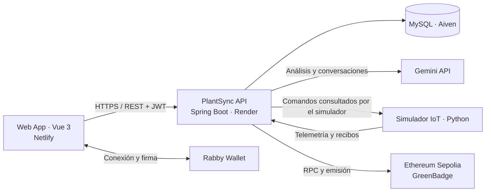

<div align="center">

# 🌱 PlantSync · Web Service

### El cuidado de las plantas, conectado.

API de **NaturaTech** para gestionar jardines, interpretar imágenes y coordinar cuidados con inteligencia artificial, IoT y recompensas digitales.


[Aplicación web](https://plantsync-app.netlify.app/) · [Repositorio frontend](https://github.com/1ASI0728-2620-9077-NaturaTech/NaturaTech-web-app) · [OpenAPI](https://plantsync-backend.onrender.com/v3/api-docs) · [Swagger UI](https://plantsync-backend.onrender.com/swagger-ui/index.html)

</div>

---

## Acerca del proyecto

**PlantSync** reúne el seguimiento de plantas y sus cuidados en una plataforma web. El usuario organiza su jardín, programa tareas, vincula dispositivos y consulta información para tomar decisiones sobre el riego, la luz y la salud de sus plantas.

Este repositorio contiene el **backend REST**, responsable de la identidad, las reglas de negocio, la persistencia y las integraciones externas. El navegador consume la API; las credenciales de Gemini, MySQL y la cuenta emisora blockchain permanecen en el servidor.

## Funcionalidades

| Área | Qué ofrece |
|---|---|
| Identidad y acceso | Registro, inicio de sesión con JWT, perfiles y roles de usuario y administrador. |
| Jardín personal | Gestión de plantas, parámetros de cuidado y asociación con su propietario. |
| Cuidados | Programación de tareas, registro de cumplimiento e historial. |
| Dispositivos IoT | Registro y vinculación de nodos, telemetría y seguimiento de comandos. |
| Análisis de imágenes | Procesamiento asíncrono con Gemini, observaciones, recomendaciones e historial. |
| Asistente de IA | Conversaciones y propuestas de riego o luz sujetas a confirmación y validaciones. |
| Recompensas | Verificación de billeteras por firma, retos de 30 días y emisión de medallas en Sepolia. |

> **Alcance:** el código incluye los flujos de IA, IoT y Web3. Su disponibilidad depende de las credenciales, los dispositivos autorizados y el contrato configurados en cada entorno. `/api/v1/capabilities` informa las capacidades habilitadas; no sustituye una prueba real del proveedor. El entorno IoT previsto es **simulado** y Sepolia es una **red de pruebas**.

## Arquitectura

El backend es un **monolito modular**: una aplicación desplegable con responsabilidades separadas por dominio. Los contextos principales se organizan en capas de interfaces REST, aplicación, dominio e infraestructura. Las operaciones de consulta y comando se separan donde corresponde, sin exigir una infraestructura de microservicios.



### Organización del código

```text
src/main/java/com/plantsync/platform/
├── iam/             # Autenticación, roles y autorización
├── profiles/        # Perfiles de usuario
├── plantprofiles/   # Plantas y parámetros de cuidado
├── tasks/           # Tareas e historial
├── iot/             # Nodos, sensores y actuadores
├── intelligence/    # Gemini, análisis y agente
├── rewards/         # Firmas, retos y emisión en Sepolia
├── analytics/       # Consultas analíticas
├── account/         # Funcionalidades de cuenta
└── shared/          # Componentes comunes y control de acceso

src/main/resources/db/migration/  # Migraciones Flyway
src/test/                        # Pruebas automatizadas
simulator/                       # Dispositivo virtual y pruebas Python
contracts/                       # Contrato Solidity GreenBadge
scripts/                         # Arranque y comprobaciones locales
```

### Tres flujos de integración

1. **Fotografía → orientación.** La API valida y normaliza la imagen, crea un trabajo y consulta Gemini. El cliente recupera su estado y resultado sin reenviar el archivo. La respuesta puede ser inconclusa: no representa un diagnóstico garantizado.
2. **Consulta → acción confirmada.** El agente propone una acción; el usuario la confirma y el servidor valida propiedad, dispositivo, lecturas recientes y límites. El simulador consulta el comando y devuelve recibos. Recepción y ejecución son estados diferentes.
3. **Constancia → medalla.** El servidor evalúa la continuidad de la telemetría. Al cumplirse la elegibilidad y estar habilitada la emisión, solicita una medalla para la billetera verificada y sigue las confirmaciones de la transacción.

## Stack tecnológico

| Capa | Tecnologías |
|---|---|
| Aplicación | Java 21, Spring Boot 3.5, Spring Web, Bean Validation |
| Seguridad | Spring Security, JWT, autorización por recurso |
| Datos | Spring Data JPA, Hibernate, MySQL, Flyway; H2 para desarrollo local |
| Integraciones | Gemini API, OpenWeather, Web3j, Solidity y OpenZeppelin |
| Calidad | JUnit 5, Mockito, Spring Boot Test, Testcontainers, JaCoCo |
| Operación | Maven Wrapper, Docker, GitHub Actions, Render y Aiven |

## Inicio local

**Requisitos:** JDK 21. Python 3.10+ para el simulador; Node.js y npm para compilar el contrato. Docker es necesario para las pruebas con MySQL real.

```bash
git clone https://github.com/1ASI0728-2620-9077-NaturaTech/NaturaTech-web-service.git
cd NaturaTech-web-service
```

En PowerShell:

```powershell
.\scripts\start-local.ps1
```

El script activa el perfil `local`, inicia la API en `http://127.0.0.1:8080` y usa H2 persistente en `.data/`. Si no existe `JWT_SECRET` en el entorno, genera uno temporal para esa ejecución. Define un secreto estable en el entorno para conservar sesiones entre reinicios.

En macOS o Linux, con `JWT_SECRET` configurado previamente:

```bash
chmod +x mvnw
SPRING_PROFILES_ACTIVE=local ./mvnw spring-boot:run
```

| Recurso local | Dirección |
|---|---|
| API | `http://127.0.0.1:8080/api/v1` |
| Swagger UI | `http://127.0.0.1:8080/swagger-ui/index.html` |
| OpenAPI | `http://127.0.0.1:8080/v3/api-docs` |
| Salud del servicio | `http://127.0.0.1:8080/actuator/health` |

### Configuración

Consulta [`.env.example`](.env.example). El perfil local puede leer `.env.local`; en Render se utilizan variables de entorno y archivos de secretos.

| Grupo | Variables principales |
|---|---|
| Identidad y web | `JWT_SECRET`, `CORS_ORIGINS`, `WALLET_DOMAIN` |
| MySQL | `DB_URL`, `DB_USERNAME`, `DB_PASSWORD`, `DB_CA_CERT_PATH` cuando aplique |
| IA y clima | `GEMINI_API_KEY`, `GEMINI_MODEL`, `WEATHER_API_KEY` |
| IoT | `IOT_ENVIRONMENT`, `EDGE_API_KEY`, `IOT_APPROVED_NODES`, `IOT_NODE_KEY_HASHES` |
| Recompensas | `REWARDS_ENABLED`, `REWARD_RULES`, `SEPOLIA_RPC_URL`, `SEPOLIA_CONTRACT`, `SEPOLIA_MINTER_KEY` |

No existe una contraseña administrativa predeterminada. El alta inicial opcional utiliza `BOOTSTRAP_ADMIN_EMAIL` y `BOOTSTRAP_ADMIN_PASSWORD`; retirar esta configuración después del aprovisionamiento.

### Simulación IoT

Crear una planta y un nodo desde la aplicación. Sustituir el código y el ID por los del mismo nodo registrado:

```powershell
python simulator/prepare.py --node-code SIM-001
# Reiniciar el backend local para cargar la configuración generada.
python simulator/iot_simulator.py --node-code SIM-001 --node-id 1
```

El simulador envía lecturas por REST y conserva un diario SQLite para deduplicar comandos. Debe permanecer en ejecución para producir telemetría; el reto de 30 días no se acelera por usar datos simulados.

## Seguridad y consistencia

- Autenticación JWT y comprobación de propiedad de los recursos en el servidor.
- Secretos fuera de Git y del frontend; autenticación específica para el gateway y los comandos del nodo.
- Límites de imágenes y consultas, validación de resultados y errores sin exponer credenciales del proveedor.
- Confirmación explícita, vencimiento y duración limitada para acciones IoT.
- Desafíos de firma con nonce y expiración; la frase semilla de Rabby nunca se solicita al usuario.
- Seguimiento de transacciones y reintentos controlados para evitar emisiones duplicadas.
- Migraciones versionadas y validación del esquema, sin repair ni baseline automáticos de bases desconocidas.

Estas medidas deben acompañarse de pruebas de integración y revisión operativa antes de considerar un entorno listo para producción.

## Pruebas y calidad

```powershell
.\mvnw.cmd test
.\mvnw.cmd verify

# Pruebas MySQL con Testcontainers: requiere Docker activo.
.\mvnw.cmd "-Dmysql.it=true" verify

python -m unittest discover -s simulator -v
```

`verify` aplica un **umbral del 80 % de cobertura de instrucciones** con JaCoCo. Los reportes se generan en `target/site/jacoco/` y `target/surefire-reports/`. El [workflow de CI](.github/workflows/verify.yml) ejecuta la verificación backend, las pruebas MySQL y las del simulador.

Para comprobar registro, permisos y persistencia con MySQL desechable:

```powershell
docker build -t plantsync-api:local .
.\scripts\smoke-docker.ps1
```

El contrato se compila desde `contracts/` con `npm ci` y `npm run build`. Compilarlo no lo despliega ni verifica una emisión real en Sepolia.

## Despliegue

El [Dockerfile](Dockerfile) construye la aplicación con Maven y ejecuta el servicio con Java 21. [render.yaml](render.yaml) describe el despliegue en Render; el perfil `render` utiliza MySQL, ejecuta Flyway y valida el esquema con Hibernate.

La arquitectura utiliza **Netlify para la web**, **Render para la API** y **Aiven para MySQL**. Configura el origen permitido del frontend, el dominio de firma, la conexión TLS de la base y los secretos de cada integración. La salud del servicio y el éxito de sus proveedores se validan por separado.

---

<div align="center">

**PlantSync · NaturaTech**

Tecnología para comprender y cuidar mejor cada planta.

</div>
